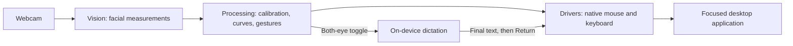

# Face-controlled accessibility interface

Control a computer with head movement, eye gestures, and speech using a webcam
and microphone. This hackathon prototype turns facial measurements into mouse
and keyboard input, with personal calibration and adjustable response curves.

The **Presentation** mode runs locally on macOS: move the pointer with your head,
open your mouth to slow it down, use your eyes to click, and dictate text into
the focused application.

## Presentation controls

| Input | Action |
| --- | --- |
| Move your head left/right or up/down | Move the pointer in that direction; small movements give fine control, larger and quicker movements increase speed |
| Return your head to its resting center | Slow down and stop |
| Open your mouth wider | Add resistance; a wide opening stops the pointer |
| Close your left eye | Press and hold the left mouse button; move your head to drag |
| Reopen your left eye | Release the left mouse button |
| Close and reopen your right eye | Right-click |
| Hold both eyes closed for 450 ms, then reopen | Start dictation; repeat to finish, type the recognized text, and press Return |

Plain eye open/closed detection is the default. **Live curves…** can require a
calibrated wink for individual eye actions. Both-eye dictation always uses
open/closed detection. For scrolling, hold the left button and drag a scrollbar.

A rising two-note sound means the microphone is listening. A falling sound means
recording has stopped; text finalization and typing follow. Pointer movement and
individual eye actions pause during dictation. Empty or cancelled dictation does
not submit anything.

## What is built

- **One native app:** Signals shows the camera, readable inputs, processed values,
  and driver status; Calibration contains the guided setup.
- **Personal control:** separate eye and head calibration, saved profiles, and
  live sliders for response, acceleration, braking, and gesture settings.
- **Measured tuning:** a target game records travel speed, target re-entry,
  precision, and movement smoothness to compare personal response settings.
- **Native output:** a C++ driver sends relative mouse movement, button events,
  Unicode text, and the main macOS Return key.
- **Local processing:** camera inference and supported macOS speech recognition
  run on-device. The app does not save dictation audio or transcripts.

## Build and run

The full presentation requires **macOS**, a webcam and microphone, **Python 3.10+
with Tk**, **CMake**, and Apple's command-line developer tools for C++ and Swift.
On-device speech recognition must be available for the system language.

From the repository root, set up the camera environment and model:

```bash
python3 -m venv Vision/.venv
Vision/.venv/bin/python -m pip install -r Vision/requirements.txt
mkdir -p Vision/.local
curl --fail --location \
  https://storage.googleapis.com/mediapipe-models/face_landmarker/face_landmarker/float16/latest/face_landmarker.task \
  --output Vision/.local/face_landmarker.task
```

Build the driver and dictation helper, then launch:

```bash
cmake -S Drivers -B Drivers/build -DFID_NATIVE_BACKEND=ON
cmake --build Drivers/build -j 4
python3 tools/build_dictation.py
Vision/.venv/bin/python -m App --source camera --mapping presentation
```

Models and environments are local setup files, so a new clone needs these steps.
See the [technical setup notes](docs/TECHNICAL_OVERVIEW.md#setup-and-runtime-modes)
for the tested model checksum, output modes, and platform boundaries.

## Give the demo

1. Load a camera profile on **Signals**, or use **Calibration** to complete Eye
   open/closed, Head X, and Head Y. Train Wink actions only if using wink mode.
   Loading a profile keeps output stopped; if capture is paused, click **Start camera**.
2. On **Signals**, select **Presentation** and click **Set up dictation**. Grant
   Camera and Accessibility access to the Python host/launcher, and Microphone
   and Speech Recognition access to **Face Controller Dictation** when requested.
   Wait for **On-device dictation ready**.
3. Select **Live mouse + keyboard**, click **Connect output**, then hold a
   comfortable resting pose with both eyes open and click **Center head & start**.
4. Move between targets, use mouth braking for precise placement, click a text
   field, and toggle dictation with both eyes. Speak after the rising cue. Toggle
   again to type and submit; return your head to center before moving again.
5. Use **Stop** to release output and cancel dictation. Tracking loss or stale
   input also stops control; resuming requires an explicit Start.

For a preview without a camera, microphone, or live OS input:

```bash
python3 -m App --source demo --mapping presentation --factory-defaults
```

This is a labeled synthetic demo, not a measurement of tracking accuracy.
[Detailed controls and troubleshooting](docs/PRESENTATION_GUIDE.md).

## How it works



**Built with:** Python · OpenCV · MediaPipe Face Landmarker · Tkinter · C++17 ·
CMake · macOS Quartz/Core Graphics · Swift · AVFoundation · Apple Speech.

Head control is the presentation focus. The repository also retains **Mouse test**,
**gaming keyboard mouse mapping 1**, and a legacy mouse/scroll mode. Pupil-based
control is experimental and does not provide calibrated screen-gaze accuracy.
Tongue detection is retired. This is a prototype; user accuracy and compatibility
with every target application are not established.

## Documentation

- [Final technical overview](docs/TECHNICAL_OVERVIEW.md): architecture, algorithms,
  signal contracts, dictation lifecycle, verification evidence, and limits.
- [Presentation runbook](docs/PRESENTATION_GUIDE.md): detailed setup and controls.
- [Target game](docs/TARGET_GAME_GUIDE.md) and
  [live curve editor](docs/LIVE_CURVE_EDITOR_GUIDE.md): personal tuning.
- [Team workflow](docs/TEAM_WORKFLOW.md) and [coordination](docs/COORDINATION.md):
  contribution rules, ownership, and implementation handoffs.

Older plans and milestone guides remain in the repository as development history.
Use the technical overview and presentation runbook for the current demo.
